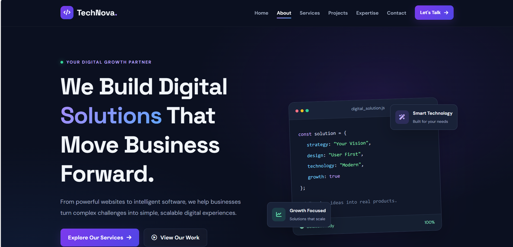

# TechNova Solutions — Business Services Page

## Project Description
TechNova Solutions is a modern business services website designed to showcase professional digital and IT solutions. The website helps potential customers explore services, understand their benefits, view featured projects, and submit service inquiries.

This project is developed as **Project 2 — Part 1: Front-End Development**.

## Features
- Responsive navigation bar with mobile hamburger menu
- Professional hero section with call-to-action buttons
- Six or more service cards
- Service categories and filtering functionality
- Detailed service information
- Why Choose Us section
- Step-by-step service process
- Technologies and expertise section
- Featured projects showcase
- Service inquiry and contact form
- Front-end form validation and success feedback
- Responsive design for mobile, tablet, and desktop
- Interactive buttons, hover effects, and smooth scrolling
- Accessible form labels and semantic HTML

## Technologies Used
- HTML5
- CSS3
- JavaScript
- Font Awesome (if used)
- Google Fonts (if used)

## Project Structure
```text
business-services-project/
├── index.html
├── css/
│   └── style.css
├── js/
│   └── script.js
├── images/
│   ├── services/
│   ├── projects/
│   └── icons/
└── README.md
```

## Services Offered
- Web Development
- Mobile App Development
- UI/UX Design
- Custom Software Development
- AI Solutions
- WordPress Development

## Getting Started
1. Download or clone this repository.
2. Open the project folder in Visual Studio Code.
3. Open `index.html` in a browser, or use the Live Server extension.
4. Explore the services, categories, featured projects, and inquiry form.

## Screenshots
Screenshots of the completed website will be added here.

## GitHub Repository
Add your GitHub repository URL here after uploading the project.

## Live Demo
Add your live website URL here after deploying the project.

## Future Improvements
- Connect the inquiry form to a backend.
- Store customer inquiries in a database.
- Manage services dynamically through an API.
- Add an admin dashboard for service management.
- Improve search and filtering features.

## Project Status
Front-end development — Part 1.

Backend integration and database functionality are planned for Part 2.

## Author
Developed as part of a front-end development project.

